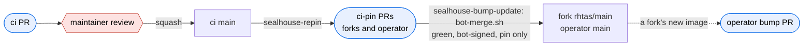

# sealhouse ci

Reusable workflows and scripts for the sealhouse lanes: the forks of the sigstore projects, the SecureSignPQC operator and its catalog.

## How the workflows connect

Rounded boxes are PRs and red hexagons are where a maintainer approves. Every other step runs by itself once its checks pass.
A merge that changes nothing an image is built from, such as a ci pin or a carried workflow, pushes no image and opens no bump.

### Upstream to the alpha channel

```mermaid
flowchart LR
  upstream[("upstream")] -->|"sealhouse-sync<br/>06:17"| mirror["fork main<br/>upstream mirror"]
  mirror -->|replay carries| syncpr(["sync PR<br/>rhtas/sync"])
  syncpr -->|"PR lane green<br/>sealhouse-sync fast-forwards"| rhtas["fork rhtas/main"]
  rhtas -->|merge lane| image[("fork image<br/>ghcr.io")]
  image -->|sealhouse-bump| bumppr(["operator bump PR<br/>images.env"])
  update["sealhouse-bump-update"] -.->|update branch| bumppr
  bumppr --> review{{"maintainer review"}}
  review -->|auto-merge| opmain["operator main"]
  opmain -->|"merge lane<br/>upgrade test"| alpha[("pqc-catalog:alpha")]
  alpha -->|sealhouse-catalog| record[("pqc-catalog repo<br/>alpha/head.env")]
  alpha -.->|"sealhouse-nightly<br/>08:40"| nightly["e2e, soak, scans"]

  classDef gate fill:#fde2e1,stroke:#c0392b,color:#000
  classDef pr fill:#e8f0fe,stroke:#1a73e8,color:#000
  class review gate
  class syncpr,bumppr pr
```

### A ci change

### A library fix in a fork

```mermaid
flowchart LR
  fix["fork rhtas/main<br/>library fix"] -->|"sealhouse-replaces 07:23<br/>release-library.sh"| tag[("fork module tag")]
  tag --> invpr(["replaces.lock PR on ci"])
  invpr --> review{{"maintainer review"}}
  review -->|auto-merge| lock["ci replaces.lock"]
  lock -->|"sealhouse-replaces<br/>replace-consumers.sh"| reppr(["replaces PRs<br/>consumer forks"])
  reppr -->|"sealhouse-bump-update: bot-merge.sh<br/>green, bot-signed, go.mod and go.sum only"| consumers["consumer rhtas/main"]

  classDef gate fill:#fde2e1,stroke:#c0392b,color:#000
  classDef pr fill:#e8f0fe,stroke:#1a73e8,color:#000
  class review gate
  class invpr,reppr pr
```

## Workflows

| Workflow | Trigger | Acts as |
|---|---|---|
| `sealhouse-sync` | 06:17 starts syncs; a sync PR's lane, and hourly, finish green ones | sealhouse-sync |
| `sealhouse-repin` | push to `main` | sealhouse-bot |
| `sealhouse-bump` | a fork's merge lane | sealhouse-bot |
| `sealhouse-bump-update` | a ci-pin or replaces PR's lane; a sync fast-forward; the operator's merge lane; hourly | sealhouse-bot |
| `sealhouse-catalog` | the operator's merge lane | sealhouse-bot |
| `sealhouse-replaces` | 07:23; `replaces.lock` push; dispatch | sealhouse-sync tags, sealhouse-bot opens PRs |
| `sealhouse-nightly` | 08:40 | the job token |
| `pr.yaml`, `merge.yaml`, `sync-merge-guard.yaml` | called from each repo's `sealhouse-*.yaml`, pinned to one ci commit | the caller; lanes hand off through sealhouse-dispatch |

`hack/status.sh` prints what waits on a maintainer, the active runs and the open PRs across the org.
