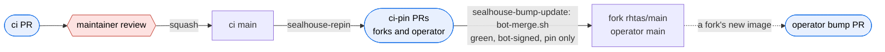
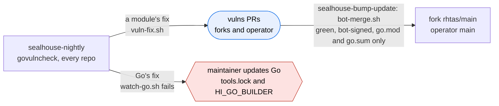

# sealhouse ci

Reusable workflows and scripts for the sealhouse lanes: the forks of the sigstore projects, the SecureSignPQC operator and its catalog.

## How the workflows connect

Rounded boxes are PRs and red hexagons are where a maintainer approves. Every other step runs by itself once its checks pass.
A merge that changes nothing an image is built from, such as a ci pin or a carried workflow, pushes no image and opens no bump.

### Upstream to the alpha channel

```mermaid
flowchart LR
  upstream[("upstream")] -->|"sealhouse-sync<br/>06:17"| mirror["fork main<br/>upstream mirror"]
  mirror -->|replay carries| syncpr(["sync PR<br/>rhtas/sync"])
  syncpr -->|"PR lane green<br/>sealhouse-sync fast-forwards"| rhtas["fork rhtas/main"]
  rhtas -->|merge lane| image[("fork image<br/>ghcr.io")]
  image -->|sealhouse-bump| bumppr(["operator bump PR<br/>images.env"])
  update["sealhouse-bump-update"] -.->|rebuild on main| bumppr
  bumppr -->|"sealhouse-bump-update: bot-merge.sh<br/>green, bot-signed, its image's digest only"| opmain["operator main"]
  opmain -->|"merge lane<br/>upgrade test"| alpha[("pqc-catalog:alpha")]
  alpha -->|sealhouse-catalog| record[("pqc-catalog repo<br/>alpha/head.env")]
  alpha -.->|"sealhouse-nightly<br/>08:40"| nightly["e2e, soak, scans"]

  classDef gate fill:#fde2e1,stroke:#c0392b,color:#000
  classDef pr fill:#e8f0fe,stroke:#1a73e8,color:#000
  class syncpr,bumppr pr
```

Bumps go one at a time, each rebuilt on the operator's main when main moves, so a bump of one image never conflicts with another's. A red bump waits for a maintainer and holds no other; a newer image closes the older bump of the same image.

### A ci change

A bot PR merges only as tested on the branch it lands on. On a fork, `bot-merge.sh` brings the oldest green bot PR that rhtas/main has moved past up to date, one at a time and only once no other bot PR is running its checks; its lane hands off to the next run, which merges it. On the operator, `bump-update.sh` does this for main.

### A library fix in a fork

```mermaid
flowchart LR
  fix["fork rhtas/main<br/>library fix"] -->|"sealhouse-replaces 07:23<br/>release-library.sh"| tag[("fork module tag")]
  tag --> invpr(["replaces.lock PR on ci"])
  invpr --> review{{"maintainer review"}}
  review -->|auto-merge| lock["ci replaces.lock"]
  lock -->|"sealhouse-replaces<br/>replace-consumers.sh"| reppr(["replaces PRs<br/>consumer forks"])
  reppr -->|"sealhouse-bump-update: bot-merge.sh<br/>green, bot-signed, go.mod and go.sum only"| consumers["consumer rhtas/main"]

  classDef gate fill:#fde2e1,stroke:#c0392b,color:#000
  classDef pr fill:#e8f0fe,stroke:#1a73e8,color:#000
  class review gate
  class invpr,reppr pr
```

A `replaces.lock` line is `<module> <fork module> <fork release> <drop when> <reason>`, the reason running to the end of the line. Its drop condition is `upstream>=vX.Y.Z`, or `upstream-pr=N` for a fix upstream has as PR `N`, met once a plain upstream release tag holds the PR's merge. The timer's `sealhouse-replaces` run lists the lines whose condition upstream has met, for a maintainer to delete. The report shows each line, how far upstream is with its condition, and which forks' `go.mod` files have its replace.

### A vulnerability with a fix

A fork's fix is a `<drop>` carry with `Go-Get` trailers, which each sync redoes until upstream has the fix. `sealhouse-bump` opens no bump for an image whose commit reaches a vulnerability with a fix.

A fix bakes first: ci takes it once its release, or for Go's own fixes the Go release, is `DAYS` old in `vulns.lock`, 7 by default. Until then the PR, the Go watch and the bump gate all wait. A vulnerability `vulns.lock` names is taken as soon as its fix is out.

### An upstream PR in a fork

A fork carries an upstream PR that has not been released as an `UPSTREAM: <N>: <subject>` commit, one commit per PR, with a line in ci's `carries.lock`: `<fork> <N> <head>`, the PR head it was taken from. The PR lane refuses a carry without its line, so the line merges on ci first. Each sync replays the carry and asks upstream about the PR:

- merged into the commit being synced, the replay should come out empty and the carry drops; if it still changes something, or conflicts, that fork's sync stops;
- `<fork> <N> <head> remove` drops the carry from the next sync, for a PR upstream merged differently or one no longer wanted;
- a fork PR with a later `UPSTREAM: <N>:` commit, the delta to the PR's new head, folds into the carry; `replaced-by <M>` on `<N>`'s line folds `<N>`'s carry into `<M>`'s.

A sync notes a `carries.lock` line whose carry has gone, for its PR to delete. The report shows each carried PR's state upstream, and links the changes since the carried head.

## Workflows

| Workflow | Trigger | Acts as |
|---|---|---|
| `sealhouse-timer` | its previous run, after the `timer` environment's wait; reports' `sealhouse-tick` when no run is waiting | the job token; sealhouse-dispatch for the operator |
| `sealhouse-sync` | 06:15 starts syncs; a sync PR's lane, and every six hours, finish green ones | sealhouse-sync |
| `sealhouse-repin` | push to `main` | sealhouse-bot |
| `sealhouse-bump` | a fork's merge lane | sealhouse-bot |
| `sealhouse-bump-update` | a ci-pin, replaces, vulns or bump PR's lane; a sync fast-forward; the operator's merge lane; every six hours | sealhouse-bot |
| `sealhouse-catalog` | the operator's merge lane | sealhouse-bot |
| `sealhouse-replaces` | 07:30; `replaces.lock` push; dispatch | sealhouse-sync tags, sealhouse-bot opens PRs |
| `sealhouse-nightly` | 08:45; the e2e, soak and rebuilds only when their inputs changed or weekly | the job token; sealhouse-bot opens vulns PRs |
| `sealhouse-report` | every hour: today so far, and yesterday until it is final | the job token reads; sealhouse-bot commits to reports |
| `pr.yaml`, `merge.yaml`, `sync-merge-guard.yaml` | called from each repo's `sealhouse-*.yaml`, pinned to one ci commit | the caller; lanes hand off through sealhouse-dispatch |

Times are UTC, from `schedule.lock`. GitHub's own schedules started hours late or not at all, so `sealhouse-timer` keeps its own time: each run starts each workflow whose time has passed with no run it started for that time, then starts the next run, a `timer link`, which waits in the `timer` environment (a 13 minute wait timer, `main` only), then up to five minutes more for the quarter hour, before it does the same. A link that did not wait fails rather than start another. Reports' `sealhouse-tick` is the only GitHub schedule left; when it fires and no link is waiting, it starts the timer again. A missed time runs once, late, and a cancelled run is started again. The timer's runs are named `timer <time>`; a run started by hand is not, and leaves the timer's alone. The operator's `sealhouse-resilience` runs at 09:45 the same way. Times are on the quarter hour, when the timer runs; a link that comes late runs at once and the next one is back on the quarter hour.

`hack/status.sh` prints what waits on a maintainer, the active runs, the timer chain and the open PRs across the org.
